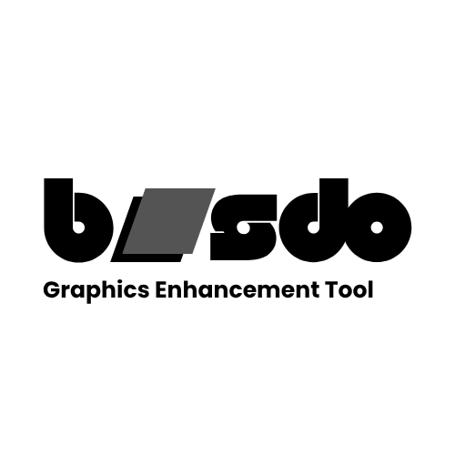

# Share blurb (copy/paste)

Wordmark (canonical share / badge asset — `logo.png` only):

Use when posting the Release link:

> buusdo **1.0.0** (unsigned): https://github.com/otas0/buusdo/releases/tag/v1.0.0  
> Windows Setup / macOS `.app` zip / Linux onedir + wheel. **Bring your own ReShade/OptiScaler kits** (not bundled). Capabilities differ by OS (macOS config-only). No DWM HDR. SmartScreen / Gatekeeper may warn. Feedback: GitHub Issues (`launch` / `scan` labels welcome).

Short:

> buusdo 1.0.0 — BYO ReShade/OptiScaler kits · Windows / Linux / macOS · https://github.com/otas0/buusdo/releases/tag/v1.0.0

## Post-1.0 fixes

Ship patch tags only after real `launch` / `scan` Issues are filed **and** fixed (fixes-only — no feature creep). Authenticode / notarization remain deferred until certs + dry-run.
